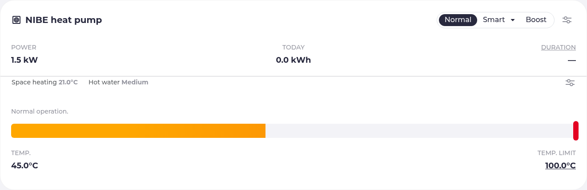
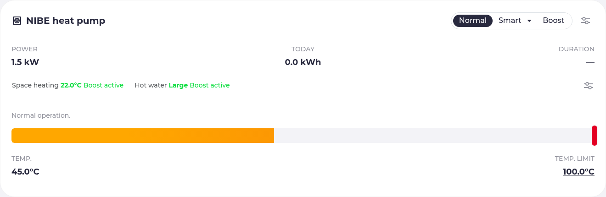
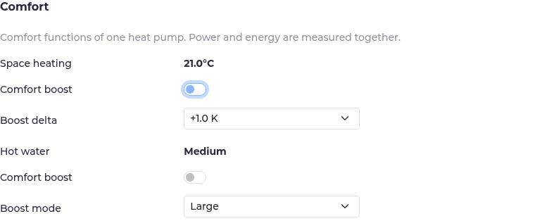

# NIBE comfort flexibility proof of concept

One SMO S40 / F2120 remains one charger, one heating loadpoint, and one physical
power/energy meter. Its space-heating and domestic-hot-water functions are optional
comfort controls in the existing heating loadpoint's settings. They do not create
loadpoints, meters, sessions, electrical capacities, or optimizer battery entries.

## Architecture and control

The existing NIBE template still constructs the generic SG Ready charger. When
enabled, it also supplies a generic `api.ThermalDevice` capability with unmetered
`api.ThermalFunction` targets. The existing plugin layer shares the Modbus
connection. The core thermal controller handles ownership, independent boost
requests, validation, and recovery; it knows no NIBE addresses.

NIBE-specific mappings stay in the template:

| Function | Direct target | Boost |
| --- | --- | --- |
| Space heating | Holding 206, signed int16, tenths of °C | Baseline plus a positive delta |
| Hot water | Holding 56, modes 0 through 4 | Select medium or large temporarily |

Normal DHW modes small, medium, large, not in use, and smart control are displayed
by name. The last two cannot be selected as boost modes. Room targets must remain
between 5 and 30 °C; deltas are 0.1 through 5 K in 0.1 K increments. Targets outside
the supported range fail without a write. No room-temperature feedback controller,
supply-temperature override, or compressor-frequency control is introduced.

Direct requests never call charger `Enable`, `Dimm`, or `MaxCurrent`. SG Ready
continues to use 6008 and status 1911; existing power control uses 6007 and 2741.
Neither direct function uses AUX selection 2740 or writes AUX state 2741. Legacy
SG Ready can still influence the shared plant, as it did before this change.

All power and energy flow through the parent's existing meter and site accounting.
The logical function state deliberately has no electrical measurements. Enabling
both requests cannot add another contribution to site power. A future optimizer
must also respect the shared compressor when allocating physical power.

## Configuration

Add the optional parameters to the existing charger, and reference it from exactly
one heating loadpoint:

```yaml
chargers:
  - name: nibe
    type: template
    template: nibe-s-series
    host: 127.0.0.1
    port: 5020
    id: 1
    tempsource: water_mid
    powercontrol: true
    roomcontrol: true
    roomboost: 1
    dhwcontrol: true
    dhwboost: large

loadpoints:
  - title: NIBE heat pump
    charger: nibe
    mode: off
```

The address above is the simulator only. Existing configurations require no
changes: both new capabilities default to disabled. Enabling them exposes
controls, but does not request a boost. Smart Room Comfort and room sensor control
must already be configured on the NIBE. This PoC does not configure SRC or verify
the real device's model/firmware register export.

The physical heating loadpoint's Normal/Smart/Boost controls retain their existing
SG Ready meaning. A compact summary below the shared power/energy display shows
the room target, hot-water mode, and active or recovery status. Click the summary
or the existing settings button to open the loadpoint settings dialog. Its Comfort
section contains independent Space heating and Hot water switches, boost
parameters, and detailed recovery messages. It uses the same form layout as the
established settings. Boost parameters can be edited while the function is idle;
settings survive restarts.

Compact card with normal comfort targets:



Both independent requests active, with one shared power reading:



Comfort controls in the existing settings dialog:



[Full settings dialog](images/nibe-settings.png), [settings with both boosts active](images/nibe-settings-active.png),
[mobile card](images/nibe-mobile.png),
[German mobile card](images/nibe-mobile-de.png),
and [German mobile settings](images/nibe-settings-mobile-de.png) show the responsive
layout. Parameters and switches stay in the dialog on small screens as well.

## Examples and optimizer boundary

At a normal room target of 21 °C, request a +1 K room boost during an attractive
electricity period. The device target becomes 22 °C, while NIBE/SRC still decides
whether to heat, the supply temperature, and compressor operation. Remove the
request afterwards to return to 21 °C. An expensive period removes preload; this
path never disables normal heating.

Independently, request a hot-water boost from medium to large, then remove it to
restore medium. Room and DHW requests may both be active. A caller can request just
one, remove either, and leave the other untouched.

This PoC supports manual UI control and the following generic API. It does not
automatically schedule either function by electricity price:

```text
GET  /api/loadpoints/1/thermal
POST /api/loadpoints/1/thermal/spaceHeating/boost/true
POST /api/loadpoints/1/thermal/spaceHeating/boost/false
POST /api/loadpoints/1/thermal/spaceHeating/config {"delta":1.5}
POST /api/loadpoints/1/thermal/domesticHotWater/boost/true
POST /api/loadpoints/1/thermal/domesticHotWater/config {"mode":"large"}
```

State is also published as `loadpoints[].thermal` through the existing state API
and WebSocket. `requested` is caller intent; `active` means the device still holds
an owned boost value. They differ after external changes, during restoration, or
when DHW was already in the requested mode. `available`, `ownershipLost`, and
`pendingRestore` explain these cases. Mode/target readings are absent when a read
fails, avoiding a stale value being shown as current.

The optimizer currently represents batteries and EV charging goals. It does not
have a comfort or thermal-storage model suitable for these functions. Its future
integration point is `loadpoint.API.SetThermalBoost(kind, bool)` and independent
`SetThermalBoostConfig` values. Separate price policies can call those methods
without Modbus knowledge. Electrical-storage "stop" suggestions must not be
translated into turning off normal room heating. Thermal state estimation,
comfort bounds, forecast-driven scheduling, and joint compressor constraints need
agreement before extending the optimizer. No optimizer refactor is included.

Preload may move some heating to cheaper periods and the independent controls make
comfort choices clearer. The simulator does not model building response, DHW heat
storage, COP, or target-driven compressor demand, so no energy saving, cost saving,
or real thermal performance improvement is claimed.

## Ownership and restart recovery

Each function is serialized by the core controller. Before writing, evcc reads the
current value and records its baseline and intended boost in the existing settings
database, flushing the record before the device write. Settings are scoped by the
stable charger reference and function kind. A hash of the getter/setter connection
configuration binds an ownership record to its target.

When removing a boost, evcc reads again and restores the baseline only when the
current value equals the value it wrote. For example, after 21 -> 22, a manual
change to 20 loses ownership; removing the request leaves 20 untouched. Polling
detects changes while a request is active and blocks further acquisition until the
request is cleared. Repeated true requests cannot accumulate the room delta.

If DHW was already in the selected mode, evcc makes no write and takes no ownership.
A subsequent manual change is left untouched until a new off/on request.

After restart, evcc loads ownership records but never resumes boost requests. It
conditionally restores previous baselines. Unavailable reads or failed restoration
writes retain the record and are retried by the normal update loop. An interrupted
or failed boost write retains its prewritten ownership record: if the write took
effect but its acknowledgement was lost, evcc can remove it safely; if it did not
take effect, the unchanged baseline causes the record to be released without a
write. A persistence failure prevents a new device write.

An invalid record or changed connection identity with pending ownership prevents
controller initialization instead of applying a stale baseline to another device.
Clear boosts and finish restoration before changing connection settings, renaming
the charger, disabling a function in configuration, or deleting the database. If
the record/database is absent, evcc adopts the current device target as normal and
cannot infer a previous boost. Database backups also carry the ownership records.

Modbus offers no compare-and-swap for these registers. A manual change to exactly
the same value is indistinguishable from evcc's write. A change between the final
read and restoration write cannot be detected atomically. This implementation
protects observed later changes; it cannot promise transactional coordination with
other writers. Coordinate external target automation when that stronger guarantee
is required. A thermal controller also cannot restore anything while evcc is down.

## Simulator validation

Only the read-only main branch of
[johannesz-codes/nibe-sim](https://github.com/johannesz-codes/nibe-sim) is used.
The exercised contract is commit `eaf9fa2f3bc0c79a3f4c3556c80475606dd13a86`.
It exposes Modbus on 127.0.0.1:5020 with device ID 1, HTTP state/events on
127.0.0.1:8080, and POST /reset. No real NIBE or home infrastructure is contacted.

With the simulator running and its Python dependencies installed:

```sh
make ui build
NIBE_SIM=1 NIBE_SIM_PYTHON=/path/to/nibe-sim/venv/bin/python \
  vpx playwright test tests/nibe-thermal.spec.ts --workers=1
```

The test uses the actual rendered NIBE template, evcc binary, browser controls,
state API, simulator state, event history, and direct external Modbus writes. It
covers room 21 -> 22 -> 21, medium -> large -> medium, independent/simultaneous
requests, manual changes, parameter editing/persistence, normal and hard restarts,
SG Ready and power-limit coexistence, and shared plant accounting. With 5000 W grid
power and one 4500 W plant, home power remains 500 W with both functions enabled.
The simulator event history verifies that AUX selection 2740 is never written.

Core unit tests additionally cover connection loss during restore, restoration
write failures, rejected/ambiguous enable writes, settings persistence failures,
corrupt ownership, device identity changes, repeated requests, and already-large
DHW. API tests cover state serialization, device errors, and malformed parameters.
Template tests cover all four opt-in combinations and existing SG Ready registers.
The simulator's own suite remains unchanged.

## Questions for upstream maintainers

Discuss the generic comfort-target capability, persisted ownership lifecycle and
device identity, the parent heating-card presentation, and suitable thermal price
policies. Verify the real SMO S40 register export and firmware bounds, SRC
prerequisites, and simultaneous physical room/DHW scheduling before recommending
deployment. The simulator proves control contracts and accounting, not hardware
timing, compressor arbitration, or efficiency.
